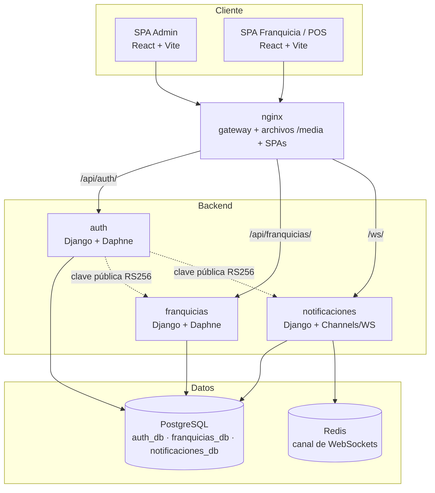

# Arquitectura — FRANQOR (`franquisisas`)

Documento de referencia de la arquitectura del sistema: estilo, servicios,
comunicación, datos, seguridad y despliegue.

---

## 1. Veredicto: ¿Clean Architecture o microservicios?

Dos preguntas distintas, dos respuestas:

- **A nivel de sistema → Microservicios (sí, de verdad).**
  Tres servicios independientes, cada uno con su **propia base de datos** y sus
  propias credenciales, desplegables por separado, detrás de un **gateway nginx**
  y desacoplados por **JWT (RS256)**. No hay base de datos compartida ni foreign
  keys entre servicios: el enlace es por `id` + el token firmado.

- **Dentro de cada servicio → Arquitectura por capas con una capa de servicios
  (NO Clean Architecture pura).**
  Separamos la lógica de negocio de la capa web (vive en `services.py`, no en las
  vistas), lo que toma el **espíritu** de Clean/Hexagonal (separación de
  responsabilidades, reglas de negocio aisladas del HTTP). Pero **no** es Clean
  Architecture de manual: la capa de servicios importa el ORM de Django
  directamente, no hay inversión de dependencias (ports/adapters), ni repositorios,
  ni entidades independientes del framework.

**En una frase:** microservicios con *database-per-service* y comunicación por
JWT, y dentro de cada uno una arquitectura por capas pragmática (web → servicios →
ORM) con un núcleo transversal (`core/`). Es una decisión deliberada: Clean
Architecture pura sería sobre-ingeniería para el alcance actual.

---

## 2. Vista de alto nivel



---

## 3. Servicios y responsabilidades

| Servicio | Rol | Stack | Base de datos |
|---|---|---|---|
| `auth` | Identidad, usuarios, roles/subroles, emisión de JWT | Django + DRF + SimpleJWT + Daphne (ASGI) | `auth_db` |
| `franquicias` | Dominio del negocio: franquicias, menú, inventario/bodega, ventas (POS), clientes, mesas, solicitudes, reportes | Django + DRF + Daphne (ASGI) | `franquicias_db` |
| `notificaciones` | Tiempo real (WebSockets) | Django + Channels + channels-redis | `notificaciones_db` |

Cada servicio es un proyecto Django independiente con su propio `config/`
(settings, asgi, urls), su app de dominio y su `manage.py`. Todos corren sobre
**Daphne (ASGI)** para soportar WebSockets.

---

## 4. Comunicación

- **Gateway nginx** enruta por prefijo: `/api/auth/` → auth, `/api/franquicias/`
  → franquicias, `/ws/` → notificaciones, `/media/` → archivos, `/admin/` y `/` →
  las dos SPAs. Usa resolver dinámico de Docker para sobrevivir a reinicios de
  contenedores.
- **Autenticación entre servicios por JWT asimétrico (RS256):**
  `auth` **firma** los tokens con la **clave privada**; `franquicias` y
  `notificaciones` solo **validan** con la **clave pública** compartida
  (`/keys/public.pem`). No hay llamadas síncronas entre servicios para validar
  sesión → bajo acoplamiento.
- **Claims del token:** `sub`, `username`, `role` (`ADMIN`/`FRANQUICIA`),
  `sub_rol` (`ADMIN_FRAN`/`CAJERO`), `franquicia_id`, `debe_cambiar`.
- **Sin base de datos compartida ni FKs entre servicios.** El enlace lógico es por
  `id` (p. ej. `franquicia_id` viaja en el token y se usa para el scoping).

---

## 5. Datos

- **Un PostgreSQL** con **tres bases lógicas separadas** (`auth_db`,
  `franquicias_db`, `notificaciones_db`), cada una con su **usuario y clave
  propios** → aislamiento por servicio (*database-per-service* a nivel lógico).
- **Redis** como *channel layer* de Channels para los WebSockets (con contraseña).
- Convenciones de esquema (nombres, auditoría, índices, multi-tenant): ver
  [`CONVENCIONES_BD.md`](CONVENCIONES_BD.md).
- **Multi-tenant (modelo A):** toda tabla de negocio lleva `franquicia_id` y toda
  consulta se filtra por el `franquicia_id` del **JWT firmado**, nunca por un
  parámetro del frontend.

---

## 6. Estructura interna de un servicio (las capas)

Tomando `franquicias` como ejemplo:

```
services/franquicias/
├── config/            # settings, asgi, urls (framework / drivers)
├── core/              # núcleo transversal (reutilizable entre servicios)
│   ├── models.py          # ModeloBase (creado_en / actualizado_en)
│   ├── authentication.py  # validación JWT con clave pública (RS256)
│   ├── permissions.py     # EsAdmin, EsFranquicia, EsAdminFranquicia, …
│   ├── email.py           # envío de correos (Resend)
│   └── validators.py      # validación de imágenes
└── franquicias/       # app de dominio
    ├── models.py          # Entidades + persistencia (ORM Django)
    ├── services.py        # CAPA DE SERVICIOS: reglas de negocio
    ├── serializers.py     # Validación / (de)serialización
    ├── views.py           # Adaptadores HTTP (ViewSets / APIViews)
    └── urls.py            # Ruteo
```

**Flujo de una petición:** `urls → views (HTTP) → services (negocio) → models (ORM) → PostgreSQL`,
con `serializers` validando/serializando en los bordes.

La **capa de servicios** (`services.py`) concentra las reglas que no deben vivir en
las vistas, por ejemplo:
- `registrar_venta` — descuenta inventario por receta, **bloquea si no hay stock**,
  calcula el nº de orden continuo y el vuelto, y dispara la alerta de stock bajo.
- `registrar_compra` / `transferir_a_franquicia` — bodega general → franquicia, con
  bloqueo si el central no alcanza.

> **Por qué NO es Clean Architecture pura:** `services.py` importa los modelos de
> Django directamente (la dependencia apunta al framework). En Clean Architecture
> las reglas de negocio serían *use cases* que dependen de **interfaces**
> (repositorios), y el ORM sería un detalle intercambiable. Aquí priorizamos
> simplicidad y velocidad sobre esa indirección.

---

## 7. Frontend

Dos SPAs independientes en **React 18 + Vite + Tailwind v4** (iconos `lucide-react`,
gráficas `recharts`):

- **Admin** (`/admin/`) — gestión: dashboard, franquicias, menú, bodega general,
  inventario, solicitudes, reportes, usuarios.
- **Franquicia / POS** (`/`) — punto de venta, órdenes, menú, inventario,
  solicitudes, usuarios de la franquicia, configuración (croquis de mesas).

Ambas comparten el **mismo login** (vive en la SPA de franquicia) y se redirige por
el `role` del token. Las imágenes se sirven con rutas relativas (`/media/…`) para
funcionar detrás del proxy sin problemas de host/puerto.

---

## 8. Seguridad

- **JWT RS256** (firma asimétrica): solo `auth` tiene la clave privada.
- **Access + refresh** con rotación; el frontend hace *refresh* en un solo vuelo
  (single-flight) al recibir 401.
- **Permisos por rol/subrol** en el backend (no solo en la UI): `EsAdmin`,
  `EsFranquicia`, `EsAdminFranquicia`.
- **Scoping multi-tenant** forzado por el `franquicia_id` del token.
- **Cambio de contraseña obligatorio** en el primer ingreso (`debe_cambiar`).
- Validación de imágenes (tipo y tamaño) y límite en nginx.

---

## 9. Despliegue

- **Docker Compose** orquesta: `postgres`, `redis`, `auth`, `franquicias`,
  `notificaciones`, `frontend-admin`, `frontend-franquicia`, `nginx`, y los
  volúmenes `pgdata` (datos) y `media` (imágenes subidas).
- **nginx** es el único punto de entrada: sirve las SPAs, enruta la API y los
  WebSockets, y publica `/media/`. En producción, un **NPM** (Nginx Proxy Manager)
  puede ir por delante para TLS y dominio.
- Cada backend corre con **Daphne (ASGI)** para soportar HTTP y WebSockets.

---

## 10. Decisiones y trade-offs

| Decisión | Por qué | Trade-off |
|---|---|---|
| Microservicios + DB-per-service | Aislamiento por dominio, escalado y despliegue independiente | Más piezas que mantener; algo de duplicación (`core/` por servicio) |
| JWT RS256 (validación con clave pública) | Sin llamadas síncronas al servicio de auth; bajo acoplamiento | Rotación/propagación de claves hay que gestionarla |
| Capa de servicios (no Clean pura) | Simplicidad y velocidad; reglas fuera de las vistas | Acoplado al ORM; cambiar de framework costaría más |
| Un Postgres con 3 bases lógicas | Aislamiento sin operar 3 clústeres | No es aislamiento físico total |
| ASGI/Daphne + Channels/Redis | WebSockets para tiempo real | Más complejo que WSGI puro |

**Qué faltaría para Clean Architecture pura** (si algún día se quisiera): definir
*use cases* y *repositorios* como interfaces, mover las entidades a objetos
independientes del ORM, e inyectar las implementaciones (Django) desde fuera. Hoy
no se justifica por el alcance.
